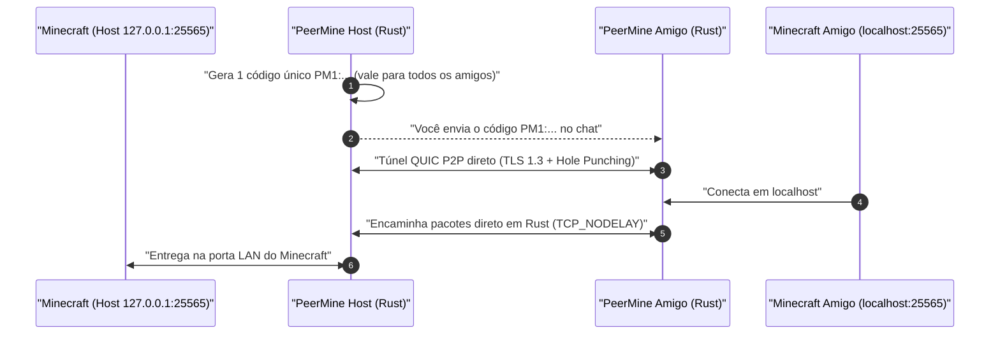

# PeerMine

Túnel P2P nativo em **Rust + QUIC (`iroh`)** para jogar **Minecraft (LAN ou servidor local)** com amigos pela internet, **sem Hamachi, sem VPN e sem abrir portas no roteador**.

---

## Como funciona (100% P2P nativo)

---

## Por que usar o PeerMine no lugar do Hamachi?
- **Sem driver de VPN no Windows:** não instala adaptador de rede virtual e não precisa de administrador.
- **Um único código para vários amigos:** o Host gera um código `PM1:...` e todos os amigos podem entrar usando esse mesmo código.
- **Menor latência:** o tráfego TCP do Minecraft é encaminhado diretamente em **Rust (`tokio` + `iroh`)** com `TCP_NODELAY` (sem passar pelo WebView2/JS), evitando o lag de servidores relay distantes.
- **Criptografia ponta a ponta:** QUIC com **TLS 1.3** obrigatório.
- **Isolamento:** CSP estrita (`script-src 'self'`), permissões Tauri mínimas (`core:default`), sem acesso a arquivos ou shell.

---

## Como usar
1. **Quem vai abrir o mundo (Host):**
   - Abra seu mundo no Minecraft → `ESC` → **Abrir para LAN** (anote a porta, ou use `25565` se for servidor).
   - No PeerMine, digite a porta e clique em **Hostear Mundo** → **Copiar Código** e mande para os amigos.
2. **Amigos:**
   - Cole o código `PM1:...` no PeerMine e clique em **Entrar no Mundo**.
   - No Minecraft, vá em **Multiplayer → Conexão Direta** e digite **`localhost`** (ou `127.0.0.1:<porta>`).
